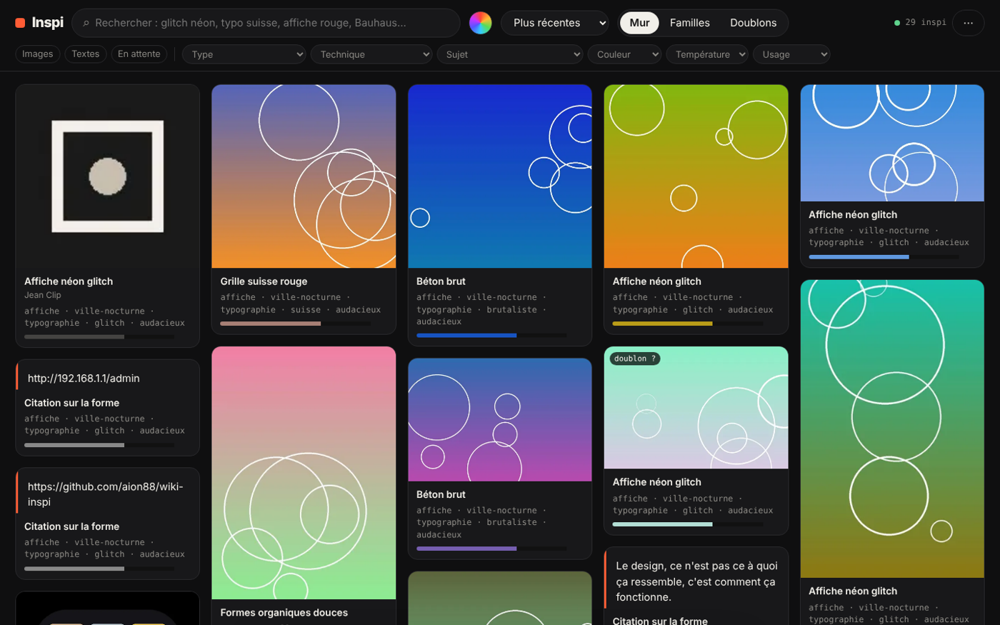
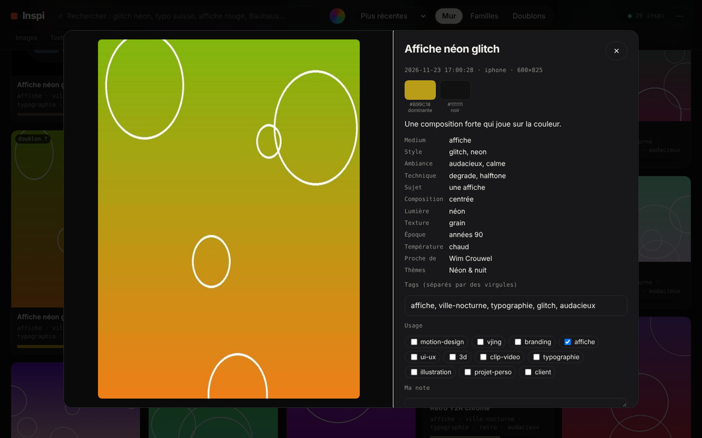
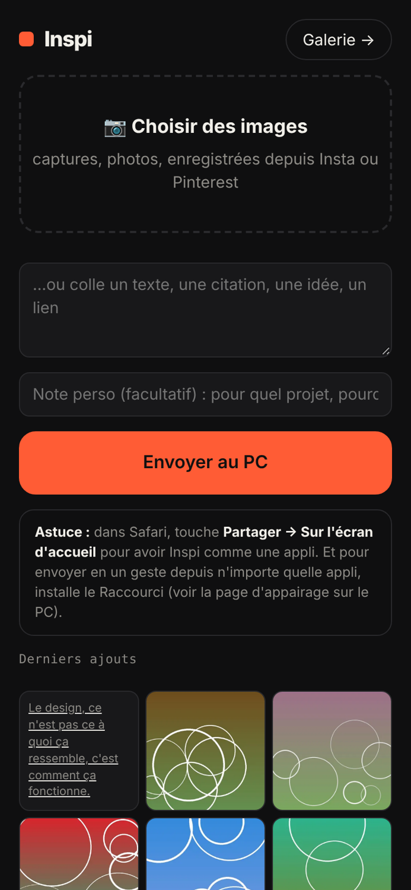
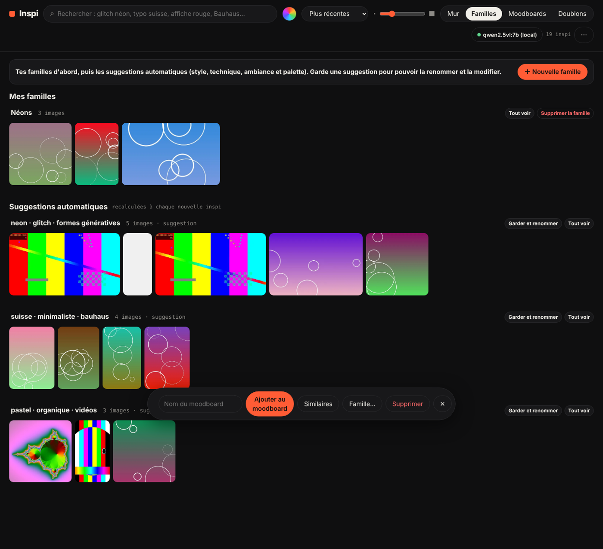
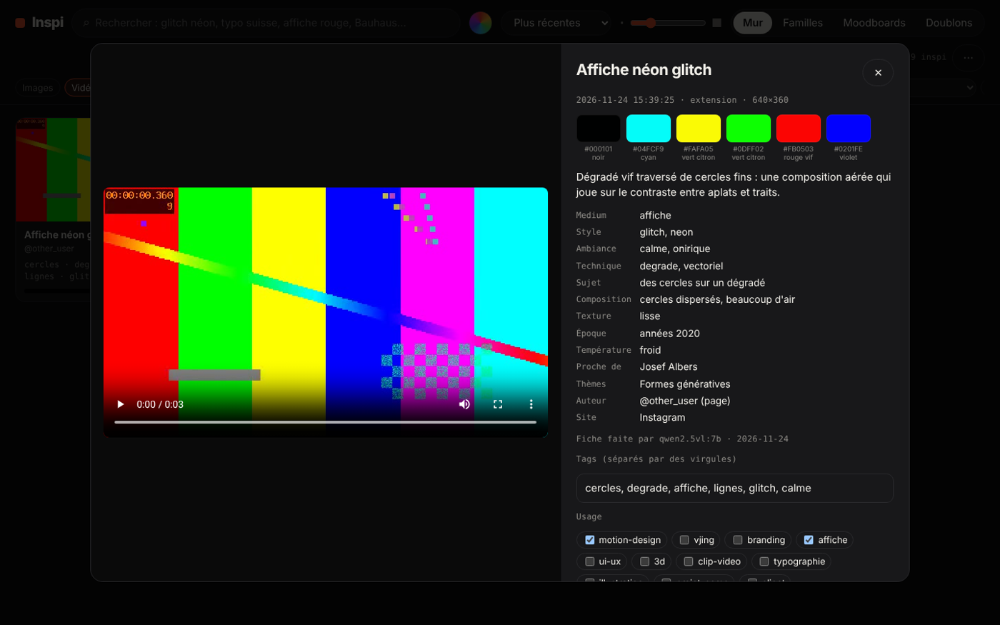
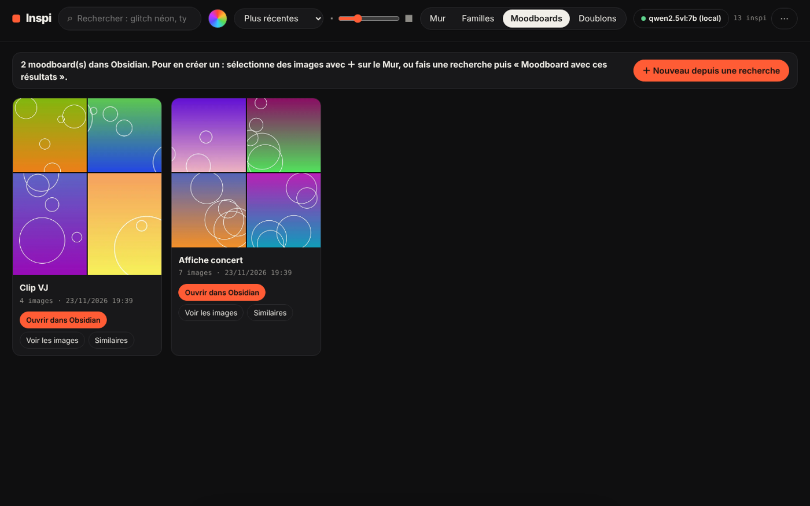
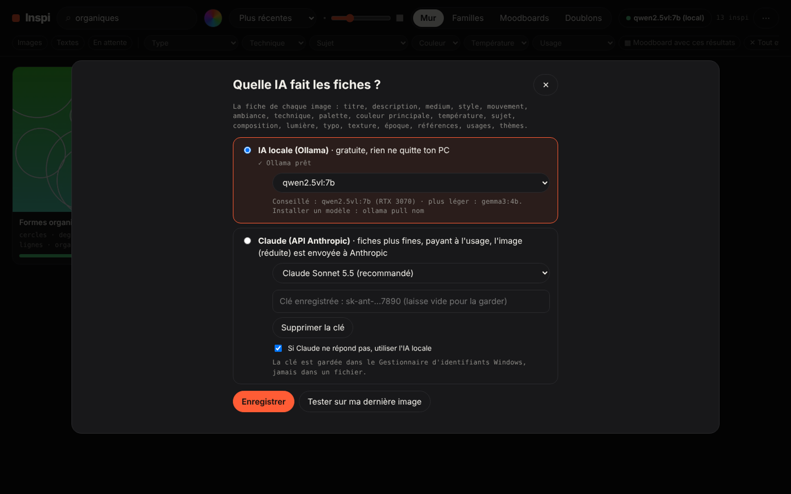
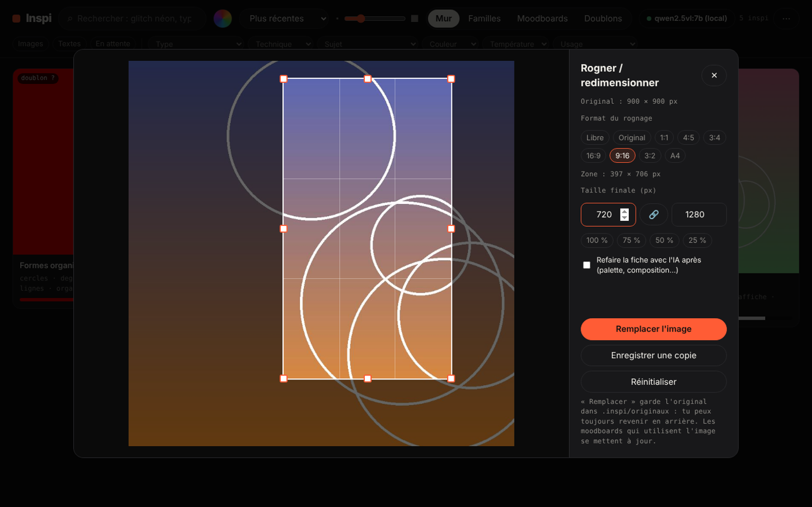

<div align="center">

# Wiki Inspi · Windows + iPhone app

**Ta bibliothèque d'inspirations visuelles, sur ton PC Windows et dans ta poche.**
Capture une image ou une vidéo en un geste (iPhone, navigateur, Instagram, dossier). Une IA en fait une fiche détaillée (style, technique, ambiance…) et la palette est mesurée sur les pixels. Tu la retrouves par couleur, par style ou par ressemblance, et tu la poses dans des moodboards Excalidraw, dans Obsidian.


*Version Windows + iPhone de [wiki-inspi](https://github.com/aion88/wiki-inspi) d'aion88 (macOS).*



</div>

---

## Sommaire

1. [En bref](#en-bref)
2. [Nouveautés par rapport à la V1 (wiki-inspi)](#nouveautés-par-rapport-à-la-v1-wiki-inspi)
3. [Captures](#captures)
4. [Prérequis](#prérequis)
5. [Installation sur Windows](#installation-sur-windows)
6. [Installer l'app iPhone](#installer-lapp-iphone)
7. [Installer l'extension Chrome / Edge](#installer-lextension-chrome--edge)
8. [Configurer Obsidian](#configurer-obsidian)
9. [Utilisation](#utilisation)
10. [Choisir l'IA : locale ou Claude](#choisir-lia--locale-ou-claude)
11. [Réglages](#réglages)
12. [Mettre à jour](#mettre-à-jour)
13. [Dépannage](#dépannage)
14. [Sécurité et vie privée](#sécurité-et-vie-privée)
15. [Structure du projet](#structure-du-projet)
16. [Crédits et licence](#crédits-et-licence)

---

## En bref

```
iPhone (Raccourci, app web) ──┐
Extension Chrome / Edge ──────┤                                         ┌─ Library/     une note .md par inspi
Obsidian Web Clipper ─────────┼─► Inspi (PC Windows) ─► IA ─► Coffre ───┼─ assets/      les images
Dossier « Inspi Drop » ───────┤        │            (Ollama   Obsidian   ├─ Moodboards/  boards Excalidraw
Glisser / Ctrl+V ─────────────┘        │             ou Claude)          └─ Thèmes/      notes de thème
                                       └─► Galerie web : http://127.0.0.1:18765 (PC et iPhone)
```

- **Tout reste chez toi** : les images, les notes et l'IA locale tournent sur ton PC. L'iPhone parle au PC directement par ton Wi‑Fi.
- **Une fiche par image ou vidéo** : titre, description, medium, style, mouvement, ambiance, technique, sujet, composition, lumière, typo, texture, époque, artistes proches, usages et thèmes. La palette (couleurs nommées, part de chaque couleur, couleur principale, accent, température) est calculée sur les pixels.
- **Des outils de designer** : recherche par couleur, images similaires, familles modifiables, moodboards, rognage et redimensionnement.

---

## Nouveautés par rapport à la V1 (wiki-inspi)

> **Nouveau en 2.1** : vidéos (fichiers, iPhone, Reels Instagram enregistrés pendant la lecture), clic droit sur Instagram avec le nom du profil, couleurs mesurées sur les pixels, familles modifiables et mieux formées, retrait d'une image d'un moodboard, tri du mur par type (images, vidéos, captures d'écran, textes, liens). Détail dans le [journal des versions](CHANGELOG.md).

La V1, [wiki-inspi](https://github.com/aion88/wiki-inspi) d'aion88, tourne sur **macOS** avec une extension Chrome/Brave et un dossier de dépôt. Cette version garde l'esprit et une partie des idées de la V1, et ajoute tout ce qui suit.

### 💻 Windows
| | V1 | Cette version |
|---|---|---|
| Système | macOS uniquement | **Windows 10 / 11** |
| Installation | script shell | **`install.bat` en un double‑clic** (Python, dépendances, modèle d'IA, plugins Obsidian, icônes, extension) |
| Lancement | service launchd | **icône sur le bureau** et dans le menu Démarrer, **icône dans la barre des tâches** (menu : galerie, appairage, coffre, journal…), lancement au démarrage de Windows, **une seule instance** (l'icône rouvre la galerie si l'appli tourne déjà) |
| Secrets | Trousseau macOS | **Gestionnaire d'identifiants Windows** |
| Pare‑feu | n/a | script `pare-feu-admin.bat` (réseaux privés uniquement) |
| Commande | `inspi` (shell) | `inspi.bat` (search, board, doctor, plugins, reclasser, raccourcis, extension…) |

### 📱 App iPhone (nouveau)
- **Appairage par QR code** : tu scannes avec l'appareil photo, c'est tout.
- **Raccourci iOS « Inspi »** dans le menu **Partager** de toutes les applis (Photos, Pinterest, Instagram, Safari…), pour une ou plusieurs images.
- **Partage de liens** : tu partages un lien Pinterest, Behance ou d'un site, et le PC va chercher l'image de la page lui‑même (l'**original HD** pour Pinterest).
- **Double tape au dos de l'iPhone** pour envoyer une capture d'écran au PC.
- **App web installable** sur l'écran d'accueil : choisir des photos, écrire une note ou une citation, voir les derniers ajouts et ouvrir la galerie complète.
- **Photos HEIC** de l'iPhone converties automatiquement.

### 🤖 IA
- **Choix de l'IA depuis l'appli** : **Ollama en local** (gratuit, rien ne quitte le PC) ou **Claude** (API Anthropic), avec un menu des modèles.
- **Repli automatique** sur l'IA locale si Claude ne répond pas.
- Bouton **« Tester sur ma dernière image »**, qui affiche la fiche complète sans rien enregistrer.
- **Contrôle des fiches** : s'il manque un champ (style, technique, palette…), l'IA est relancée en lui disant précisément ce qui manquait. Les fiches encore incomplètes sont signalées (badge et filtre).
- **Liste d'usages fermée** (`use_for`), à adapter à ton métier (motion design, VJing, branding…).
- Le texte des pages est envoyé à l'IA comme une donnée, jamais comme une instruction (protection contre l'injection de consignes).

### 🖼 Galerie web (nouvelle interface)
- **Curseur de taille** des images, mémorisé.
- **Recherche par couleur** : pastille arc‑en‑ciel, distance perceptuelle Lab, et double‑clic sur une couleur de la palette pour chercher cette couleur.
- **Filtres** : type, technique, sujet, couleur, température, usage, plus tags, images, textes, en attente, erreurs, fiches incomplètes.
- **Tris** : récentes, anciennes, couleur, titre, famille, moodboard.
- **Images similaires** (depuis une image ou une sélection), vue **Doublons** avec la copie à garder suggérée.
- **Familles** (2.1) : suggestions automatiques plus cohérentes (style, medium, technique, thèmes et palette complète, voisins réciproques uniquement), et **tes propres familles** : créer, renommer, ajouter ou retirer des images, garder une suggestion.
- **Tri par type** (2.1) : images, vidéos, captures d'écran (détectées automatiquement), textes, liens.
- **Corbeille avec « Annuler »** : une image utilisée dans un moodboard n'est jamais effacée.
- **Glisser‑déposer** et **Ctrl+V** d'une image ou d'un lien.
- **Fiche complète** affichée, avec tags, usages et note modifiables, et un lien vers la source et les autres endroits où l'image a été vue.
- **Diagnostic intégré** et menu **⋯** (réglages IA, appairage, extension, reclassement).
- Interface **responsive** : la même galerie s'ouvre sur l'iPhone.

### ✂️ Éditeur d'images (nouveau)
- **Rogner** à la souris (formats libre, original, 1:1, 4:5, 3:4, 16:9, 9:16, 3:2, A4) et **redimensionner** (pixels ou 75 / 50 / 25 %, proportions verrouillables).
- **Remplacer** en gardant l'original (bouton **↺ Revenir à l'original**), ou **enregistrer une copie**.
- La transparence des PNG est conservée, et les moodboards se mettent à jour.

### 🧩 Moodboards
- Création **depuis une sélection**, **depuis une recherche** (« Moodboard avec ces résultats ») ou en ligne de commande.
- **Retirer une image d'un moodboard** (2.1) sans la supprimer du mur : onglet Moodboards → *Voir les images* → ✕ sur l'image.
- **Onglet Moodboards** avec aperçu (mosaïque), et pour chaque board : ouvrir dans Obsidian, voir les images, images similaires.
- Ajouter des images à un board existant ne déplace rien, même s'il est compressé, et une sauvegarde est faite avant chaque écriture.
- Titre, légendes (titre, auteur, site) et bande de palette sur chaque board.

### 🎬 Vidéos (2.1)
- Ajout de **vidéos** depuis le PC (glisser-déposer, dossier), l'iPhone (menu Partager) ou le navigateur.
- **Reels et vidéos Instagram** : clic droit → *Envoyer à Inspi* enregistre la vidéo pendant sa lecture (60 s max, avec le son), avec le **@profil** et le lien du post. Ou *Envoyer l'image affichée de la vidéo* pour un plan fixe.
- Les vidéos iPhone (HEVC) sont converties en MP4 pour se lire partout ; image d'aperçu, durée, lecture dans la galerie et dans Obsidian.
- La fiche IA d'une vidéo est faite sur 4 images clés (mouvement, rythme, transitions).

### 🌐 Capture
- **Extension Chrome *et* Edge**, qui se **connecte toute seule** à l'appli (pas de jeton à recopier). Elle envoie une image, un texte, un lien ou la page entière, avec une notification.
- **Auteur** lu sur la page (Pinterest, Behance, Are.na, Wikimedia, métadonnées). L'IA peut seulement proposer une *estimation*, affichée avec son niveau de confiance.
- **Doublons à l'arrivée** : une image identique n'est pas recréée, la nouvelle source est ajoutée à sa fiche.
- **Clic droit à travers les calques** (2.1) : Instagram, Pinterest, Behance… l'extension trouve elle-même l'image ou la vidéo sous le curseur, et lit le **@profil Instagram** et le lien du post.
- **Obsidian Web Clipper** : modèles fournis, et les notes clippées sont importées automatiquement.

### 🗂 Obsidian
- Note d'accueil **`_Inspi`**, vues **Bases** en cartes (par couleur, style, ambiance, technique, usage, medium, auteur) et **notes de thème** créées automatiquement.
- **Installation automatique** des plugins Dataview et Excalidraw dans le coffre.

---

## Captures

| Fiche d'une image | App iPhone | Familles |
|---|---|---|
|  |  |  |

| Vidéo |
|---|
|  |

| Moodboards | Réglages de l'IA | Rogner / redimensionner |
|---|---|---|
|  |  |  |

*Captures faites avec des images de test.*

---

## Prérequis

| | |
|---|---|
| **PC** | Windows 10 ou 11 |
| **Carte graphique** (IA locale) | NVIDIA avec 8 Go de VRAM conseillés (ex. RTX 3060 / 3070) pour `qwen2.5vl:7b`. Avec moins, prends `gemma3:4b`. Sans carte graphique : utilise Claude |
| **Logiciels** | [Python 3.11+](https://www.python.org/downloads/) (coche *Add python.exe to PATH*), [Ollama](https://ollama.com/download), [Obsidian](https://obsidian.md) 1.9+ |
| **iPhone** (facultatif) | iOS 16+, sur le **même Wi‑Fi** que le PC |
| **Navigateur** (facultatif) | Google Chrome ou Microsoft Edge |
| **Espace disque** | environ 7 Go (modèle d'IA compris) + tes images |

---

## Installation sur Windows

1. **Installe les prérequis** : Python (coche *Add python.exe to PATH*), Ollama et Obsidian.
2. **Télécharge le projet** : bouton vert **Code → Download ZIP**, puis dézippe‑le à un endroit où il restera, par exemple `Documents\wiki-inspi`.
3. **Double‑clique sur `install.bat`.** Il fait tout, environ 10 à 15 minutes la première fois :
   - crée l'environnement Python et installe les dépendances ;
   - télécharge le modèle de vision `qwen2.5vl:7b` (environ 6 Go) ;
   - installe les plugins Obsidian **Dataview** et **Excalidraw** ;
   - crée l'icône **Inspi** sur le bureau et dans le menu Démarrer, et lance Inspi au démarrage de Windows ;
   - propose d'installer l'extension dans **Chrome** ou **Edge**.
4. **Double‑clique sur l'icône Inspi** du bureau. L'icône orange apparaît près de l'horloge et la galerie s'ouvre.
5. Quand Windows demande l'accès réseau pour Python, coche **Réseaux privés** uniquement. C'est ce qui permet à l'iPhone de joindre le PC.

> Tout est prêt quand le point en haut à droite de la galerie est **vert**. S'il est rouge, lance le **Diagnostic** (menu ⋯).

---

## Installer l'app iPhone

Le PC et l'iPhone doivent être sur le **même Wi‑Fi**.

### 1. Appairer l'iPhone (30 secondes)
1. Sur le PC : clic sur l'icône orange près de l'horloge, puis **Appairer l'iPhone** (ou galerie → **⋯ → Appairer l'iPhone**).
2. Sur l'iPhone : ouvre l'**appareil photo**, vise le QR code et touche le lien jaune.
3. Safari ouvre **Envoyer à Inspi** : l'iPhone est appairé.
4. Dans Safari : **Partager → Sur l'écran d'accueil**. Tu as maintenant l'app **Inspi** sur ton iPhone.

### 2. Créer le Raccourci « Inspi » (envoi en un geste depuis toutes les applis)
La page d'appairage du PC affiche l'**URL** et l'**en‑tête** à copier. Dans l'app **Raccourcis** :

1. **＋** → nomme le raccourci **Inspi**.
2. Touche **ⓘ** → active **Afficher dans la feuille de partage**. Dans « Recevoir », garde **Images, Médias, Texte, URL, Pages web Safari** (Médias = les vidéos). Si aucune entrée : **Demander → Photos**.
3. Ajoute **Répéter avec chaque élément** (de *Entrée du raccourci*). Le bloc **Fin de la répétition** s'ajoute tout seul.
4. **À l'intérieur** de la boucle, ajoute **Obtenir le contenu de l'URL** :
   - URL : `http://<IP-du-PC>:18765/api/capture`
   - Méthode : **POST**
   - En‑tête : `Authorization` = `Bearer <ton jeton>`
   - Corps de la requête : **Formulaire**, avec un champ **Fichier** `file` = *Élément de répétition* et un champ **Texte** `source` = `iphone`
5. **Après** « Fin de la répétition » : **Afficher la notification** « Envoyé à Inspi ✅ ».

Le raccourci doit ressembler à ceci :
```
Recevoir Images, Texte, URL… depuis la feuille de partage
Répéter avec chaque élément de Entrée du raccourci
    Obtenir le contenu de http://192.168.x.x:18765/api/capture
        POST · Authorization : Bearer … · Formulaire : file = Élément de répétition, source = iphone
Fin de la répétition
Afficher la notification « Envoyé à Inspi ✅ »
```

### 3. Bonus : capture d'écran en deux tapes au dos de l'iPhone
Duplique le raccourci et remplace l'entrée par l'action **Prendre une capture d'écran**. Puis **Réglages → Accessibilité → Toucher → Toucher le dos → Toucher deux fois** → choisis ce raccourci.

> 💡 Fixe l'adresse IP du PC dans ta box. Sinon, si elle change, il faudra mettre à jour l'URL du raccourci (la page d'appairage affiche toujours la bonne).

---

## Installer l'extension Chrome / Edge

`install.bat` le propose déjà. Sinon : galerie → **⋯ → Installer l'extension**, ou `inspi extension chrome` / `inspi extension edge`.

1. Le navigateur s'ouvre sur sa page **Extensions**, et le dossier de l'extension s'ouvre aussi.
2. Active le **Mode développeur** (Chrome : en haut à droite · Edge : dans le panneau de gauche).
3. **Charger l'extension non empaquetée** → colle le chemin du dossier (il est déjà copié) avec **Ctrl+V**.
4. C'est tout : l'extension se connecte seule à Inspi. Fais un clic droit sur une image → **Envoyer à Inspi**.

> Chrome peut proposer, au démarrage, de désactiver les extensions en mode développeur : clique sur la croix pour la garder.

---

## Configurer Obsidian

1. Dans Obsidian : **Gérer les coffres → Ouvrir un dossier comme coffre** → choisis **`Documents\Inspi`**.
2. Clique **Faire confiance à l'auteur et activer les modules** (Dataview et Excalidraw sont déjà installés).
3. Ouvre la note **`_Inspi`** : c'est l'accueil.

| Élément | Contenu |
|---|---|
| `_Inspi` | Accueil : dernières captures, moodboards, thèmes, file d'attente |
| `_Inspi.base` | Vues en cartes : par couleur, style, ambiance, technique, usage, medium, auteur, et un tableau |
| `Library/` | Une note par inspi classée (image, description, palette, analyse, source) |
| `Inbox/` | Inspi en attente de classement (et notes Web Clipper à importer) |
| `Moodboards/` | Boards Excalidraw |
| `Thèmes/` | Une note par thème, qui liste ses inspi |
| `assets/` | Les images |

---

## Utilisation

### Capturer
| D'où | Comment |
|---|---|
| **iPhone** | Partager → **Inspi** (image, vidéo ou lien), l'app Inspi de l'écran d'accueil, ou deux tapes au dos |
| **Navigateur** | Clic droit → **Envoyer à Inspi** (image, vidéo, texte sélectionné, lien, page), y compris sur Instagram |
| **Reel Instagram** | Clic droit sur la vidéo → **Envoyer à Inspi** : un bandeau « ● Inspi enregistre » s'affiche ; clique dessus pour arrêter avant la fin |
| **Galerie** | Glisser‑déposer des fichiers, ou **Ctrl+V** d'une image ou d'un lien |
| **Obsidian Web Clipper** | Importe les modèles du dossier `clipper/` (créé au premier lancement) |
| **Dossier** | Dépose des fichiers dans `Inspi Drop` (dans ton dossier utilisateur) |

Chaque inspi passe par trois étapes : **récupération** (pour un lien), puis **classement par l'IA**, puis **rangement** dans `Library/`. Compte 10 à 30 secondes par image avec l'IA locale.

### Retrouver
- **Recherche** : tape des mots (« glitch néon », « typo suisse », « Bauhaus », un nom d'artiste…).
- **Couleur** : clique sur la pastille arc‑en‑ciel, ou double‑clique sur une couleur dans une fiche.
- **Filtres et tris** : sous la barre de recherche.
- **Taille** : le curseur en haut, à côté du tri.
- **Images similaires** : depuis une fiche, ou depuis une sélection avec le bouton *Similaires*.
- **Familles** : onglet *Familles*, pour voir des groupes d'images proches.
- **Doublons** : onglet *Doublons*, avec la copie à garder entourée en vert.

### Familles
Onglet **Familles** : *Garder et renommer* une suggestion pour la rendre modifiable, ✕ sur une image pour la retirer, clic sur le nom pour le changer. Sur le Mur : sélection (**＋**) → **Famille…** pour ajouter des images à une famille ou en créer une.

### Modifier une fiche
Clique sur une image : tu peux modifier le titre, les tags, les usages et ta note. Tu peux aussi **Reclasser**, **Supprimer** (avec *Annuler*) ou ouvrir la note dans **Obsidian**.

### Rogner et redimensionner
Dans une fiche : **✂ Rogner / redimensionner**. Choisis un format, ajuste le cadre, règle la taille finale, puis **Remplacer l'image** (l'original est gardé) ou **Enregistrer une copie**. Coche *Refaire la fiche avec l'IA* si l'image change beaucoup.

### Moodboards
- **Sélection** : **＋** sur les images → nom → **Ajouter au moodboard**.
- **Recherche** : cherche ou filtre → **Moodboard avec ces résultats**.
- **Onglet Moodboards** : aperçus, **Ouvrir dans Obsidian**, voir les images, similaires.

### Ligne de commande
Depuis le dossier du projet :
```bat
inspi search "glitch neon" --color bleu --limit 10
inspi search --style suisse --mood calme --json
inspi board "risographie" --name "Affiche concert"
inspi doctor           :: vérifie toute l'installation
inspi reclasser        :: reclasse les anciennes fiches (--tout pour toutes)
inspi plugins          :: (ré)installe Dataview et Excalidraw
inspi raccourcis       :: recrée les icônes
inspi extension edge   :: prépare l'extension pour Edge (ou chrome)
inspi open | map       :: ouvre l'accueil Obsidian | la galerie
```

---

## Choisir l'IA : locale ou Claude

Clique sur le **nom de l'IA** en haut à droite de la galerie (ou **⋯ → Réglages IA**).

| | IA locale (Ollama) | Claude (API Anthropic) |
|---|---|---|
| Coût | gratuit | payant à l'usage |
| Confidentialité | rien ne quitte le PC | l'image réduite est envoyée à Anthropic |
| Qualité des fiches | bonne (`qwen2.5vl:7b`) | plus fine (Sonnet, Opus) |
| Matériel | carte graphique conseillée | aucun |
| Réglage | choisir le modèle installé | coller la clé API ([console.anthropic.com](https://console.anthropic.com)) |

- **Tester sur ma dernière image** affiche la fiche produite, sans rien enregistrer.
- L'option *Si Claude ne répond pas, utiliser l'IA locale* évite que tes inspi restent bloquées.
- Pour refaire toutes tes fiches avec la nouvelle IA : **⋯ → Tout reclasser**.

---

## Réglages

### `config.yml` (créé au premier lancement)
| Clé | Défaut | Rôle |
|---|---|---|
| `vault` | `Documents\Inspi` | Dossier du coffre Obsidian |
| `drop_folder` | `Inspi Drop` | Dossier surveillé |
| `host` | `0.0.0.0` | `127.0.0.1` pour couper l'accès iPhone |
| `port` | `18765` | Port du serveur |
| `ai_backend` | `ollama` | `ollama` ou `claude` (modifiable depuis la galerie) |
| `ollama_model` | `qwen2.5vl:7b` | `gemma3:4b` si tu fais tourner TouchDesigner, Blender ou un jeu en même temps |
| `claude_model` | `claude-sonnet-5-5` | Modèle Claude |
| `ai_fallback` | `true` | Repli sur l'IA locale si Claude échoue |
| `ollama_keep_alive` | `2m` | Durée pendant laquelle le modèle reste en VRAM après un classement |

### `inspi/taxonomy.yml`
- **`use_for`** : ta liste **fermée** d'usages. L'IA ne choisit que parmi ceux‑là. À personnaliser.
- **`themes`** : les thèmes de départ.
- **`vocabulaire`** : les mots suggérés à l'IA pour le medium, le style, la technique et l'ambiance.
- **`synonyms`** : ramène les variantes à un seul tag (`riso` → `risographie`, `gradient` → `degrade`…).

Redémarre Inspi après modification (icône orange → **Quitter**, puis icône du bureau).

---

## Mettre à jour

1. Icône orange près de l'horloge → **Quitter**.
2. Télécharge la nouvelle version et **copie ses fichiers par‑dessus** l'ancien dossier, en remplaçant les fichiers existants. Ne supprime pas le dossier : `.venv` et `config.yml` y sont.
3. Relance **`install.bat`** (rapide : le modèle est déjà téléchargé).
4. Dans la galerie : **⋯ → Reclasser les anciennes notes**.

Tes inspi (`Documents\Inspi`) ne sont jamais touchées.

---

## Dépannage

Commence toujours par **⋯ → Diagnostic** (ou `inspi doctor`). Il vérifie Python, les dépendances, le coffre, l'IA, le serveur, l'accès iPhone, le pare‑feu, les plugins et l'espace disque, et donne la correction de chaque problème.

| Problème | Solution |
|---|---|
| Point rouge « Ollama ne répond pas » | Lance l'app Ollama |
| « Modèle absent » | `ollama pull qwen2.5vl:7b` |
| L'iPhone n'arrive pas à joindre le PC | Même Wi‑Fi ? Réseau réglé en **privé** dans Windows ? Sinon lance `pare-feu-admin.bat` en administrateur |
| Le raccourci marchait, puis plus rien | L'IP du PC a changé : réaffiche la page d'appairage et mets à jour l'URL |
| Rien dans Obsidian | Ouvre bien `Documents\Inspi` comme coffre, puis active les modules |
| `_Inspi.base` vide ou en erreur | Mets Obsidian à jour (1.9+) |
| Blocs de code au lieu de listes dans `_Inspi` | Active le plugin Dataview |
| Fiches incomplètes | ⋯ → Réglages IA → **Tester**, essaie un autre modèle ou Claude, puis **Reclasser** |
| Lien Instagram gardé comme simple lien | Instagram demande d'être connecté : utilise plutôt le clic droit de l'extension sur la photo ou la vidéo |
| « Vidéo non enregistrable » | Le site bloque l'enregistrement : l'image affichée est gardée à la place, avec le lien |
| Vidéo iPhone longue à arriver | Les vidéos HEVC sont converties en MP4 sur le PC : compte quelques secondes par minute de vidéo |
| Voir ce qui se passe | `start-console.bat` (journal en direct) ou `Documents\Inspi\.inspi\inspi.log` |

---

## Sécurité et vie privée

- **Appairage par jeton** : seuls tes appareils appairés peuvent envoyer. Le jeton est stocké dans le Gestionnaire d'identifiants Windows, et un bouton permet d'en générer un nouveau.
- **Protection du navigateur** : les autres sites ouverts dans ton navigateur ne peuvent ni écrire dans Inspi ni lire le jeton (origine et hôte vérifiés, protection contre le *DNS rebinding*). Les tentatives refusées sont journalisées.
- **Liens** : quand le PC télécharge un lien, les adresses locales ou privées (box, NAS…) sont refusées, et la taille comme la durée sont plafonnées.
- **Clé Claude** : gardée dans le Gestionnaire d'identifiants Windows, jamais dans un fichier du projet.
- **Ce qui n'est jamais publié** : `.gitignore` exclut `config.yml`, le jeton, la clé API et l'environnement Python.
- À utiliser sur ton **Wi‑Fi personnel** (réseau « privé »), pas sur un Wi‑Fi public.

---

## Structure du projet

```
wiki-inspi/
├─ install.bat            installation complète
├─ start.bat              lancement (comme l'icône du bureau)
├─ start-console.bat      lancement avec journal visible
├─ inspi.bat              ligne de commande
├─ pare-feu-admin.bat     règle de pare-feu (réseaux privés)
├─ run.py                 point d'entrée (serveur, IA, icône de la barre des tâches)
├─ requirements.txt
├─ inspi/                 le cœur
│  ├─ server.py           API locale, appairage, sécurité
│  ├─ enrich.py           IA (Ollama / Claude), fiches, contrôle de complétude
│  ├─ store.py            notes Obsidian, index SQLite, corbeille, éditeur d'images
│  ├─ fetcher.py          récupération des liens (og:image, Pinterest HD)
│  ├─ similar.py          similaires, familles (auto + les tiennes), doublons
│  ├─ media.py            vidéos (aperçu, images clés, conversion)
│  ├─ boards.py           moodboards Excalidraw
│  ├─ colors.py           palette mesurée (Lab), noms des couleurs, filtres
│  ├─ obsidian.py         coffre, vues Bases, plugins, Web Clipper
│  ├─ winsetup.py         icônes Windows, installation de l'extension
│  ├─ doctor.py · cli.py · watcher.py · auth.py · config.py
│  └─ taxonomy.yml        ton vocabulaire et tes usages
├─ web/                   galerie, app iPhone, appairage
├─ extension/             extension Chrome / Edge
└─ docs/captures/         images du README
```

---

## Crédits et licence

- **V1 : [wiki-inspi](https://github.com/aion88/wiki-inspi)** de Cynthia Ortu (aion88), sous licence MIT. Plusieurs idées et parties de code en sont adaptées : schéma de classement, filtres, similarité et familles, format des moodboards Excalidraw, décompression LZString, lecture de l'auteur dans l'extension. Détail dans [`THIRD_PARTY.md`](THIRD_PARTY.md).
- **Version Windows + iPhone** : Alexis Allain ([lxs-visual](https://github.com/lxs-visual)), motion designer et graphiste. Développée avec l'aide de Claude (Anthropic).
- Licence **MIT** : voir [`LICENSE`](LICENSE).

Voir aussi le [journal des versions](CHANGELOG.md).
